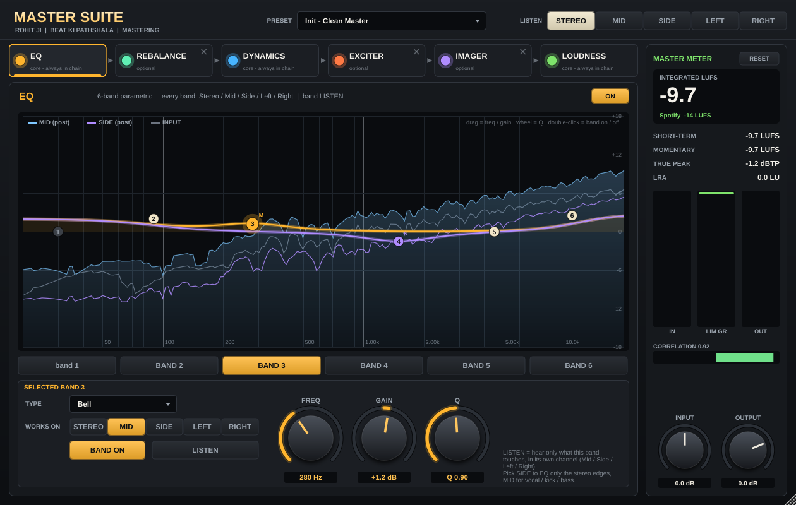

# Master Suite (ROHIT JI | Beat Ki Pathshala)

A mastering suite VST3 for Windows (64-bit and 32-bit).

## Modules (signal flow)

`EQ -> REBALANCE -> DYNAMICS -> EXCITER -> IMAGER -> LOUDNESS`

| Module | Always on? | What it does |
|---|---|---|
| **EQ** | yes | 6-band parametric EQ. Every band can work on **Stereo, Mid, Side, Left or Right**. Band **LISTEN** lets you hear only what a band touches. Live spectrum of mid and side. |
| **REBALANCE** | optional | Moves whole frequency regions up or down; each band on its own channel mode; SOLO. |
| **DYNAMICS** | yes | 4-band transparent compressor (no colour, only control) + **GLUE** bus compressor with sidechain HPF and mix. Every band: channel mode, SOLO, GR meter. |
| **EXCITER** | optional | 4-band harmonics: **Tube, Tape, Transformer, Console, Crystal**. Every band has its own emulation, drive and channel mode (nothing is linked). Runs at 2x sample rate. |
| **IMAGER** | optional | 4-band width, vectorscope, **correlation meter**, per-band phase check (red when a band goes below 0), width-by-frequency view. |
| **LOUDNESS** | yes | EBU R128 meter (integrated, short-term, momentary, LRA, true peak) + true-peak maximizer. Targets: Spotify, Spotify Loud, YouTube, Apple Music, Amazon Music, Tidal, Deezer, SoundCloud, CD/Club, Custom. **MATCH TARGET** sets the gain for you. |

Optional modules are added with **+** on their tab and removed with **x**. Every module has an ON switch.
The three crossovers are shared by all multiband modules (drag them on any band graph).
The **LISTEN** switch at the top lets you monitor Stereo / Mid / Side / Left / Right.

## Build

Pushing to `main` builds both installers on GitHub Actions and publishes them under **Releases**.
Local tests: `cmake -B build -DMS_BUILD_TESTS=ON && cmake --build build --target MSTests` then run `MSTests`.
